# 小白 FDE 炼金术 · Level 1

> **一天入门，七天变现。**
> 把一个"没上过客户现场"的小白，8 天锻造成能独立跑通一条交付链路、
> 手里握着 8 件可展示产出的准 FDE（前线部署工程师）。
>
> ⚠ **"变现"指什么**：本课的"变现"= **把能力变成可展示、可检验、可对客交付的产出**
> （作品集 + 话术 + 一条亲手跑通的链路）——**不是**承诺涨薪或接单收入，
> 见下方「诚实边界」。

- **建议总投入**：约 22 小时（D1 全天 6 小时 + D2–D8 每天约 2.25 小时），8 天完课
- **知识底稿**：[`00-FDE方法论历史与原理.md`](00-FDE方法论历史与原理.md) —— 课程的**历史 / 原理 / 方法论**地基，回答"FDE 从哪来、为什么是现在、到底怎么做"
- **平台层**：[`fde-scope`](../README.md) —— 本仓库的**主页/门户 + 自研 FDE 工具与流程平台**（CLI + Web 控制台 + Python 库），零 API key 可全程跑通
- **工具纪律**：**不要求换工具**——你现有的编码 / 办公 Agent 照常用，课程只叠"流程与门禁层"，见 [`01`](01-课程设计说明书.md) §6.4
- **交付形态**：线上直播训练营（默认）/ 自学版 / 企业内训版 / 影子项目（加档）；对外价格分 **L0–L3 四档，L0 永久免费**，见 [`04-交付实施手册.md`](04-交付实施手册.md) §1.2
- **诚实边界**：本课程训练"交付能力与作品集"，**不承诺就业、不承诺收入**；所有客户案例均为虚构演示数据

---

## 1. 一句话讲清这门课

市面上讲 FDE 的内容大多停在"概念解释"：FDE 是 Palantir 发明的、薪资很高、要懂技术又懂业务。
这些话没错，但**解释不等于会用**。要把它们连成一条能走的链路，得先看底稿 [`00`](00-FDE方法论历史与原理.md)——
里面讲了这三句话背后的**历史因果、经济学原理和可执行方法论**。
**这门课不解释，只炼金**——把 4 个区、18 个阶段的完整交付链路，压缩成 8 天能亲手走完的一遍：

> **第 1 天入门**：装上世界观 + 工具箱，亲手跑通第一条迷你链路。
> **第 2–8 天变现（= 每天交出一件能拿出手的产出）**：每天过一道"门禁"（gate），交出一件老板/客户看得懂的产出。
> 第 8 天，你手里不是笔记，而是一套作品集 + 一套话术。

---

## 2. 适合谁 / 不适合谁

| 适合 | 不适合 |
|---|---|
| 刚入职或即将入职的 FDE / 交付工程师（企业内训） | 想学模型训练、微调、算法竞赛的人 |
| 想转型的技术人：测试、运维、前端、数据、后端 | 完全不碰电脑、不愿敲命令行的人 |
| 想进 AI 交付赛道的应届生、产品经理、售前、实施 | 只想听概念、不做作业的人 |
| 已经在客户现场、但总在"救火"没有章法的工程师 | 期待"包就业 / 包涨薪"的人 |

**先修要求（很低）**：能装软件、能复制粘贴命令行、能读懂表格。不需要会写 Python——
所有命令都提供可复制版本，代码细节是 Level 2 的事。

---

## 3. 学完你能拿走什么

**8 件产出（作品集）**：

| # | 产出 | 对应交付区 |
|---|---|---|
| 1 | 迷你链路跑通证据 + FDE 一页纸世界观 | 入门日 |
| 2 | 客户委托单 Engagement Charter（画像 / 干系人地图 / 成功标准） | Zone A · 定边界 |
| 3 | 数据体检报告（字段 / 缺失 / PII / 分布） | Zone B · 接数据 |
| 4 | 语料锻造报告 CorpusReport + 对客户的话术 | Zone B · 造语料 |
| 5 | 可演示原型 + 评估结果 + 3 个 bad case | Zone B · 验证与评估 |
| 6 | Runbook + SLO 卡 + 值班交接卡 | Zone C · 稳得住 |
| 7 | 交接包 Handoff Package + 1 条技能沉淀 | Zone D · 交得出去 |
| 8 | 作品集（求职版 / 内部汇报版 / 接单版三套包装） | 变现日 |

**3 项能力**：

- **知道（K）**：用大白话讲清 FDE 交付链路、4 区 18 阶段、能认出 5 个以上反模式
- **会做（S）**：独立跑通 `connect → corpus → eval → handoff` 全链路并解释每一步的为什么
- **心态（A）**：先成功标准后代码；一切产出可验证；不演 demo，交真东西

---

## 4. 学习地图

```mermaid
flowchart LR
    subgraph D1["Day 1 · 入门日（一天入门）"]
        direction TB
        A1["世界观：FDE 是什么<br/>交付链路地铁图"] --> A2["三律：先标准后代码<br/>真实数据 · 可验证"]
        A2 --> A3["工具箱：fde-scope 五分钟冒烟"]
        A3 --> A4["🎯 产出 1：迷你链路证据"]
    end
    subgraph W["Day 2–8 · 变现周（七天变现）"]
        direction TB
        B["Day 2 · Zone A 定边界<br/>🎯 客户委托单"] --> C["Day 3 · 接数据<br/>🎯 数据体检报告"]
        C --> E["Day 4 · 造语料<br/>🎯 语料报告+话术"]
        E --> F["Day 5 · 原型与评估<br/>🎯 Demo+bad case"]
        F --> G["Day 6 · 运维化<br/>🎯 Runbook+SLO"]
        G --> H["Day 7 · 交接与沉淀<br/>🎯 交接包+技能卡"]
        H --> I["Day 8 · 变现日<br/>🎯 作品集三套包装"]
    end
    D1 --> W
    A4 -.->|"G1 通关"| B
    classDef out fill:#e8f4fd,stroke:#2471a3;
    class A4,B,C,E,F,G,H,I out
```

每个 🎯 都挂着一道**课程门禁**：不交产出、或产出不含"证据"，就不能进下一关——
和 `fde-scope` 的 `Engagement.advance()` 同一个哲学：**门禁是工程，不是清单**。

> **开课前**：先花 20–40 分钟读 [`00-FDE方法论历史与原理.md`](00-FDE方法论历史与原理.md) §0 指定的两节，
> 你会带着"为什么"进 D1，而不是带着一堆要背的名词。**历史与原理不占 D1 的认知额度**（D1 只允许 3 个新概念），它们是课后读物与讲师备课底料。

---

## 5. 文档导航

**知识底稿（先读这份）**

| 文档 | 内容 | 主要读者 |
|---|---|---|
| [`00-FDE方法论历史与原理.md`](00-FDE方法论历史与原理.md) | **历史**（从哪来）· **原理**（为什么是现在）· **方法论**（到底怎么做）：Palantir 与 Ontology、范式转移与三道门槛、80/95/99 与前线学习机制、4 区 18 阶段与时间盒、来源清单与引用纪律 | 全体（学员开营前 / 讲师备课 / 面试与客户现场速查） |

**课程设计**

| 文档 | 内容 | 主要读者 |
|---|---|---|
| [`01-课程设计说明书.md`](01-课程设计说明书.md) | 学员画像、学习目标、设计原则、1+7 天架构、与 18 阶段映射、课程边界 | 课程研发、教研 |
| [`02-逐日教学大纲.md`](02-逐日教学大纲.md) | Day1–Day8 逐时段大纲：目标 / 内容 / 活动 / 产出 / 时长 / 门禁 | 讲师、教研 |
| [`03-评估体系与通关门禁.md`](03-评估体系与通关门禁.md) | 三层评估、G0–G8 门禁表、评分量表、作品集与证书标准 | 教研、助教、学员 |

**交付**

| 文档 | 内容 | 主要读者 |
|---|---|---|
| [`04-交付实施手册.md`](04-交付实施手册.md) | 四种交付形态、四档透明定价与成本算法、助教规模化、排期模板、人员配置、课前中后清单、应急预案、交付验收 | 项目负责人、运营 |
| [`05-讲师手册.md`](05-讲师手册.md) | 带教脚本、提问库、演示台词、卡点解药、控场技巧 | 讲师、助教 |
| [`06-学员手册与作业包.md`](06-学员手册与作业包.md) | 学习契约、开营前自检、8 天任务卡、自查清单、提交规范、求助路径 | 学员 |
| [`07-实战剧本与案例库.md`](07-实战剧本与案例库.md) | 5 个虚构客户案例 + Day2–8 演练剧本 + 角色卡与评分要点 | 讲师、学员 |

**逐节教案（D1–D8 逐分钟执行稿）**

| 文档 | 内容 | 主要读者 |
|---|---|---|
| [`16-D1逐节教案.md`](16-D1逐节教案.md) | Day 1 全部 8 节课：世界观 + 工具箱 + 环境冒烟 | 讲师、助教 |
| [`17-D2逐节教案.md`](17-D2逐节教案.md) | Day 2 全部 6 节课：定边界（范围、假设、验收标准） | 讲师、助教 |
| [`18-D3逐节教案.md`](18-D3逐节教案.md) | Day 3 全部 6 节课：接数据（先看再装） | 讲师、助教 |
| [`19-D4逐节教案.md`](19-D4逐节教案.md) | Day 4 全部 6 节课：造语料（把矿石炼成金属） | 讲师、助教 |
| [`20-D5逐节教案.md`](20-D5逐节教案.md) | Day 5 全部 6 节课：验证与评估（用证据说话） | 讲师、助教 |
| [`21-D6逐节教案.md`](21-D6逐节教案.md) | Day 6 全部 6 节课：运维化（让东西稳得住） | 讲师、助教 |
| [`22-D7逐节教案.md`](22-D7逐节教案.md) | Day 7 全部 6 节课：交接与沉淀（交得出去，带得走） | 讲师、助教 |
| [`23-D8逐节教案.md`](23-D8逐节教案.md) | Day 8 全部 5 节课：变现日（把 7 件产出换成职业资产） | 讲师、助教 |

**运营**

| 文档 | 内容 | 主要读者 |
|---|---|---|
| [`08-运营手册.md`](08-运营手册.md) | 招生 → 开营 → 日常 → 结营 → 复训全流程、社群 SOP、激励、FAQ | 运营、班主任 |
| [`09-运营指标与复盘.md`](09-运营指标与复盘.md) | 北极星、漏斗、健康度指标、预警线、周报/期报模板 | 运营负责人 |
| [`13-GTM页面与竞品对比.md`](13-GTM页面与竞品对比.md) | 可直接粘贴的招生页 + 竞品横向对比（含来源与查证日期）+ 优势劣势诚实评估 + 招生 FAQ + 发布前合规自查 | 运营、招生、课程负责人 |
| [`15-公信力与结果度量.md`](15-公信力与结果度量.md) | 证书边界与编号规则、第三方认证路径、对外五项结果指标与发布纪律、公信力资产待办 | 课程负责人、运营、市场 |

**变现与支撑**

| 文档 | 内容 | 主要读者 |
|---|---|---|
| [`10-变现路径与结营包.md`](10-变现路径与结营包.md) | "变现"三层定义、作品集装配、简历/汇报/面试题库、求职包与内推池规则、结营包 | 学员、就业辅导 |
| [`14-课后纵深与影子项目.md`](14-课后纵深与影子项目.md) | 结营后 90 天纵深学习路线、影子项目（形态 D）准入与数据合规、复训与进阶 | 学员、运营、课程负责人 |
| [`11-工具与环境准备.md`](11-工具与环境准备.md) | 环境安装、冒烟测试、无 key 降级路径、故障排查、数据合规 | 全体 |
| [`12-附录-术语表与模板库.md`](12-附录-术语表与模板库.md) | 中英术语表 + 全部可复制模板 + 概念→命令映射 | 全体 |
| [`en/README.md`](en/README.md) | English quickstart（**不是课文翻译**）：语言策略、8 天弧线、零 key 上手命令、诚实边界、L0–L3 档位 | 英文读者、对接人 |

---

## 6. 怎么用这套文档

- **要开一期训练营**：先读 [`00`](00-FDE方法论历史与原理.md) + `01` 定世界观与目标 → `04` 排期与建群 → `05` 备课 → `08/09` 开运营看板 → 开营。
- **企业内训（只有 3 天）**：读 `04` 的「压缩排期」一节，把 Day1+Day2+Day5 保留，其余转为自学任务；`00` 的 §1/§2 作为学员课前读物留作业。
- **自己学（无教练）**：`11` 装环境 → `00` 先建立世界观（§0 有 20/40 分钟两种读法）→ `06` 按每日任务卡做（素材取自 `07` 案例库、模板复制 `12`）→ 用 `03` 的门禁表给自己判分 → `10` 装配作品集。
  自学版**没有助教复核**，请务必自己补两件事：① 每件产出找一位同学或 AI 助手做"第三方复核"（`03` §4.1 优秀档要求）；② D5 的坏例子复盘不要跳——那是全课最值钱的一步。
- **课程迭代**：每期结束按 `09` 的期报模板复盘，改进项写回 `02/05/08`，形成课程自己的"飞轮"。

---

## 7. 设计依据（一句话版）

- **FDE 方法论 / 历史 / 原理**：见 [`00-FDE方法论历史与原理.md`](00-FDE方法论历史与原理.md)——Palantir 与 Ontology 的来路、范式转移与三道成本门槛、80/95/99 与前线学习机制、Echo·Delta 与双向蒸馏；末尾附**来源清单与引用纪律**（每个市场数字都带来源与日期，源间冲突以 ⚠ 标注不擅自定论）。
- **FDE 最佳实践**：源自本仓库 [`docs/fde_sop_full.md`](../docs/fde_sop_full.md)（4 区 18 阶段、10 门禁、12 反模式）与 [`docs/fde_playbook.md`](../docs/fde_playbook.md)（现场 72 小时手册）。
- **课程设计最佳实践**：逆向设计（先定证据再定教法）、Bloom 认知层级、认知负荷控制（每天 ≤3 个新概念）、Kolb 体验学习循环（演示 → 复盘 → 讲解 → 动手）、刻意练习与间隔重复、同伴互评。详见 `01-课程设计说明书.md` 第 5 节。

---

## 8. 版本与维护

| 项 | 说明 |
|---|---|
| 课程版本 | Level 1 · v1.0（设计稿） |
| 文档数 | 25 份（`00` 知识底稿 + `01`–`15` 主线 + `16`–`23` 逐节教案 + 本 README；`en/README.md` 为英文快速入门，另计） |
| 配套工具 | `fde-scope`，命令以仓库根 [`README.md`](../README.md) 为准 |
| 案例数据 | 全部虚构（茶语万象 / 迅捷出行 / 南湾汽车等），与真实公司无关，仅作演示 |
| 更新触发 | `fde-scope` 的 18 阶段 / 10 门禁发生变更时，同步更新 `01` 的映射表与 `02` 的大纲 |
